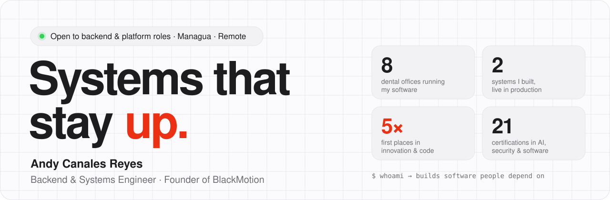
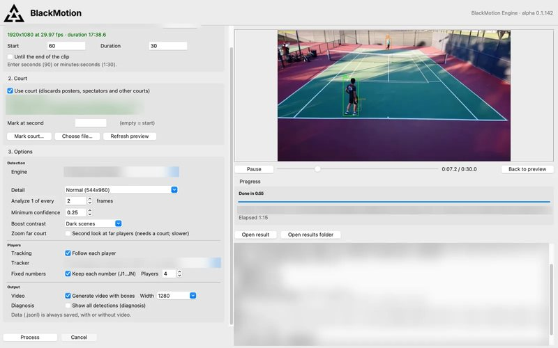
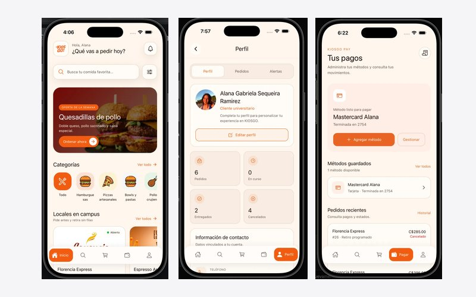
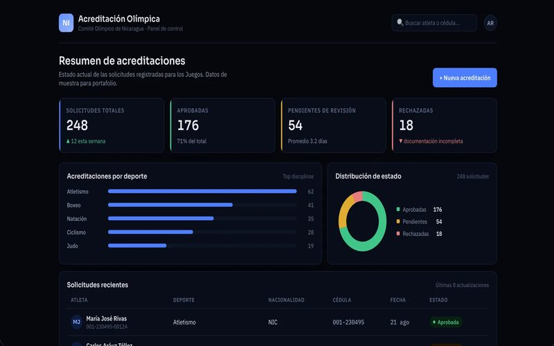
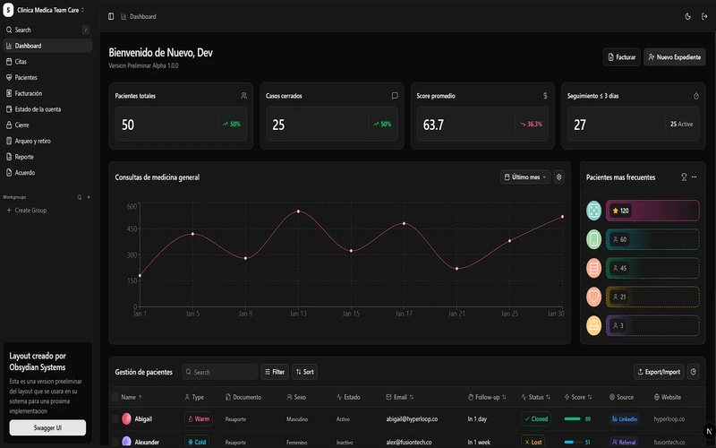

<picture>
  <source media="(prefers-color-scheme: dark)" srcset="assets/header-dark.svg">
  
</picture>

  
  
  

I build and run backends that real people depend on, for clients and for my own products. The hard parts are written up as case studies with measured results, the public repos below run as-is, and the [portfolio](https://personal-portfolio-xecy.onrender.com) has the full story. I also do machine learning in Python, from messy data to a recommendation someone can act on.

**Now** · Founder of BlackMotion, building a computer vision engine for sports 

## Case studies

| | |
|---|---|
| [**No source code. Just the database.**](https://personal-portfolio-xecy.onrender.com/cases/team-care.html) | Rebuilding Team Care's clinic system after the original engineer left with the code: reverse-engineering the database and replacing it one feature at a time, while 8 dental offices kept working. |
| [**7× faster. Every step measured.**](https://personal-portfolio-xecy.onrender.com/cases/blackmotion.html) | Taking BlackMotion Engine from 127 s to 18.2 s for 40 s of 1080p60 video, on an AMD GPU without CUDA. |
| [**Log it in a tap. Never open the app.**](https://personal-portfolio-xecy.onrender.com/cases/saldo.html) | Saldo, my iOS money tracker: Back Tap logging, six data model migrations with nothing lost, privacy and accessibility by design. |

## Selected work

<table>
  <tr>
    <td width="50%" valign="top">
      
      <h3>BlackMotion Engine</h3>
      Tracks every player in match video so local clubs get pro-level performance data. 0.46× real time on 1080p, on one computer per court. In alpha. [Case study](https://personal-portfolio-xecy.onrender.com/cases/blackmotion.html).
       <b>Founder</b> · Computer vision · Desktop app
    </td>
    <td width="50%" valign="top">
      
      <h3>KiosGo!</h3>
      Campus food pre-ordering SaaS with vendor tools and AI-personalized ads. Seed funded on the strength of the build.
       <b>Co-founder &amp; CTO</b> · Spring Boot · React · Gemini · Cloudflare R2
    </td>
  </tr>
  <tr>
    <td width="50%" valign="top">
      
      <h3>Central American Games 2025</h3>
      The accreditation system Nicaragua used for every athlete, delegation and credential. Built solo, ran live for the whole event.
       <b>Solo build</b> · PostgreSQL · Spring Boot · React
    </td>
    <td width="50%" valign="top">
      
      <h3>Team Care</h3>
      Clinical platform behind 8 dental offices. Migrated from legacy C# to Python to TypeScript while the clinic kept seeing patients. [Case study](https://personal-portfolio-xecy.onrender.com/cases/team-care.html).
       <b>Since 2023</b> · Python · SQL Server · TypeScript
    </td>
  </tr>
</table>

Screenshots of client systems use mock data.

## Open source

| Repo | What it is | Stack |
|---|---|---|
| [**InterFind**](https://github.com/Da1vReyes/InterFind) | Offline-first iOS internship finder. Solo rework of PasaFinder, my 2024 iOS diploma team project, rebuilt without an API | Swift · UIKit · Core Data |
| [**examen-servicios-web**](https://github.com/Da1vReyes/examen-servicios-web) | Full-stack IT asset lending system with role-based access. Best public sample | Spring Boot · JWT · React · MySQL |
| [**FutbolDBBackend**](https://github.com/Da1vReyes/FutbolDBBackend) | REST API for a guess-the-footballer game: auth, 12 tests, Swagger, Docker Compose | Java 17 · Spring Boot 3 · PostgreSQL |
| [**customer_churn_prediction**](https://github.com/Da1vReyes/customer_churn_prediction) | End-to-end churn model, rebuilt from my NexAfrica ML internship: 78% of churners caught | Python · pandas · scikit-learn |
| [**Tlacuachip**](https://github.com/Da1vReyes/Tlacuachip) | Hackathon app that takes first-time founders from idea to business. Icaro Prize. [Live demo](https://tlacuachip.vercel.app) | React · TypeScript · Express · PostgreSQL |
| [**CursoFinder**](https://github.com/Da1vReyes/CursoFinder) | Course finder | JavaScript |
| [**CalculadoraGraficaTuani**](https://github.com/Da1vReyes/CalculadoraGraficaTuani) | Graphing calculator | Python |

## Stack

  

Day to day: Java, Spring Boot, Python, PostgreSQL, SQL Server, Docker, Linux, React and TypeScript. Also pandas, scikit-learn and computer vision.

---

Open to backend and platform work, contract or full-time · Managua, Nicaragua · Remote

